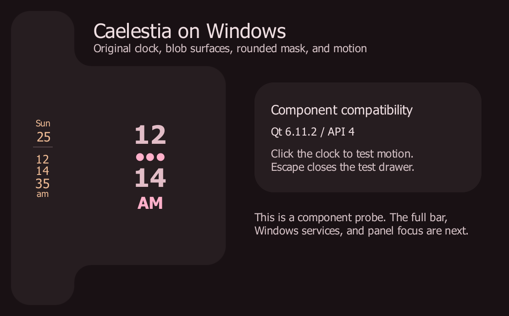

# Native Windows component result, 2026-10-25

The pinned Windows Quickshell backend and eight portable Caelestia plugins
build and run together. The original clock widgets, blob geometry, rounded
clipping, and animation render through Direct3D 11. This is an initial component
compatibility result; M1's full bar and drawer gate remains open.

## Sources and environment

- Verified implementation: `15633d6d1f6bcfb5d3634e7750784dac3d150d70`.
  The build and all three final runs recorded a clean source worktree.
- Caelestia baseline: `2e1c51fa76d94457624b642c678218970aa2517a`.
- Windows Quickshell: `e8ae0ef124b1c14b547c80d00422d2ffbd423d81`.
  The gitlink and `windows/sources.lock.json` are unchanged; no backend patch
  was needed.
- Windows 11 build 26300, x64; Visual Studio Build Tools 2022 17.14.42;
  MSVC libraries 14.44.35207; Windows SDK 10.0.26100.0.
- Qt 6.11.2 `msvc2022_64`; clang-cl 20.1.8; CMake 4.4.4;
  Ninja `1.13.2.git.kitware.jobserver-pipe-1`; CLI11 2.5.0.

[build.json](build.json) and [environment.json](environment.json) record the
actual development paths and prerequisite results. The command JSON files and
build/configure logs are archived alongside them. The final verification was
incremental on this development workstation, following successful compilation;
this is not a clean Windows profile or release-packaging test.

Use the exact setup and invocation in [NATIVE-BUILD.md](../../NATIVE-BUILD.md).
From the repository root, the rendering checks were:

```powershell
$devRoot = Join-Path $env:LOCALAPPDATA 'caelestia-dev'
foreach ($scale in @('1', '1.5', '1.75')) {
    powershell -NoProfile -File windows/scripts/Start-Prototype.ps1 `
        -QtPrefix "$devRoot\Qt\6.11.2\msvc2022_64" -Smoke -ScaleFactor $scale
    if ($LASTEXITCODE -ne 0) { throw "Rendering check failed at $scale." }
}
```

## Observed results

| Rendering scale | Reported pixel ratio | PNG dimensions | Elapsed | Result |
| --- | --- | --- | --- | --- |
| 100% | 1 | 740 x 460 | 4.112 s | [Passed](100.json) |
| 150% | 1.5 | 1110 x 690 | 4.106 s | [Passed](150.json) |
| 175% | 1.75 | 1295 x 805 | 4.081 s | [Passed](175.json) |

The checks asserted the requested device pixel ratio, opened the motion
specimen, checked its dimensions, captured the scene, closed it, and exited
successfully. Runtime logs contain `CAELESTIA_PROBE_PASS` and no warning/error
records. Pixel ratio and graphics API 4 (Direct3D 11) are recorded in each
`*.stdout.log`. The screenshots were visually inspected for clipping and layout.

The 150% result:



The [100%](100.png) and [175%](175.png) captures are also archived.
[shader-bundles.txt](shader-bundles.txt) records HLSL 5.0 payloads in the
blob, rounded-mask, and crossfade shader bundles and their SHA-256 hashes.
The crossfade bundle was inspected and imported, not exercised as a transition.

Each `*.sources.json` identifies the exact staged files and their hashes.
Original QML is copied without modification. The probe entry point receives
generated local-path pragmas; a fixed palette service is the only service
adapter. The staged font and shell license notices are retained.

The source graph exercised is `Caelestia`, `Settings`, `Components`, `Config`,
`State`, `Blobs`, `I18n`, and `Shaders`, plus the original bar clock, dashboard
clock, time service, and supporting QML primitives. The calculator, Models,
Services, Images, and Multimedia modules are excluded.

## Boundaries and remaining work

- DPI checks use child-process overrides, including a 96 DPI font baseline.
  They do not change Windows display settings or establish native DPI-change,
  mixed-monitor, or negative-origin behavior.
- A prior 20-second run after rebuilding plugins reached its screenshot at
  about 19 seconds and was stopped before completion. The raw result and logs
  are preserved as `cold-start-20s.*`. Warm runs completed in about four
  seconds. The outer limit is now 45 seconds, with timestamped logs and a
  separate 10-second in-app watchdog. The cause of the slower startup was not
  established.
- KSG Shell remained the existing desktop/tiling process. It resized the first
  ordinary probe window. The specimen now stays centered at a fixed logical
  size; its screenshot is a component capture rather than a desktop capture.
  No tiler rules, taskbar settings, autostart, or ordinary Caelestia
  configuration were changed.
- The body font is bundled. Rubik and Material Symbols coverage remains open;
  the bar clock icon is disabled. Dynamic palettes and wallpaper analysis are
  not loaded.
- No real `Bar.qml`, `ContentWindow.qml`, or drawer service graph is loaded.
  Real pointer input, panel keyboard focus, outside-click dismissal, focus
  return, transparency settings, and system services remain unvalidated.
- The Linux build was not rebuilt during this Windows milestone. Platform
  dependencies and defaults are preserved in the source changes.

The next implementation task is to adapt the service and import boundaries
needed by the real bar and one drawer, then run the complete
[M1 acceptance gate](../../ROADMAP.md#m1-actual-caelestia-compatibility-prototype).
